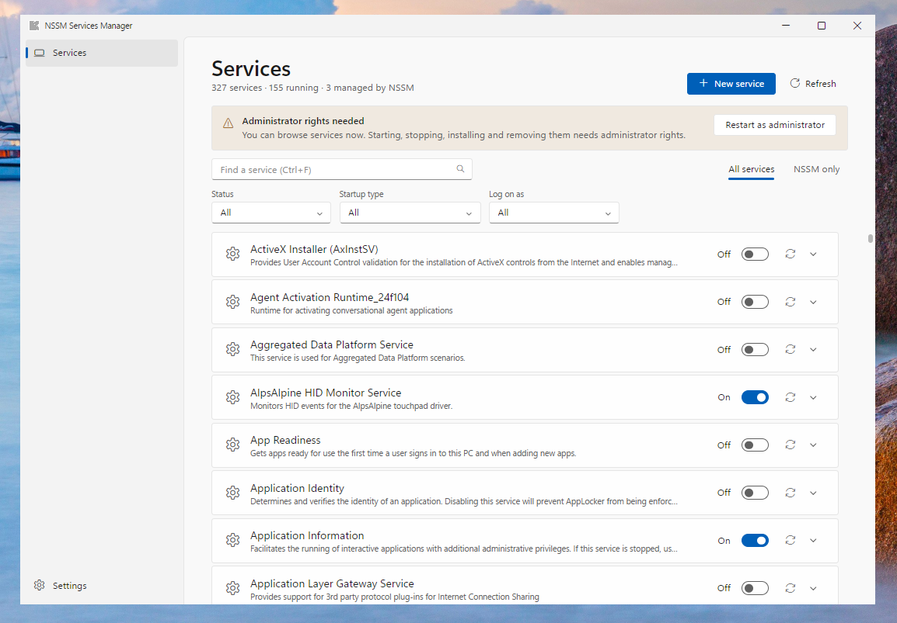
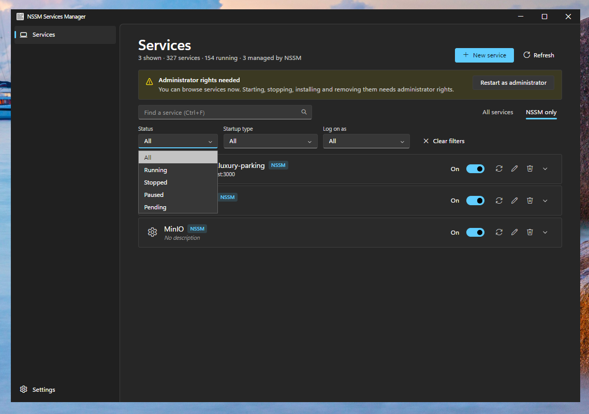
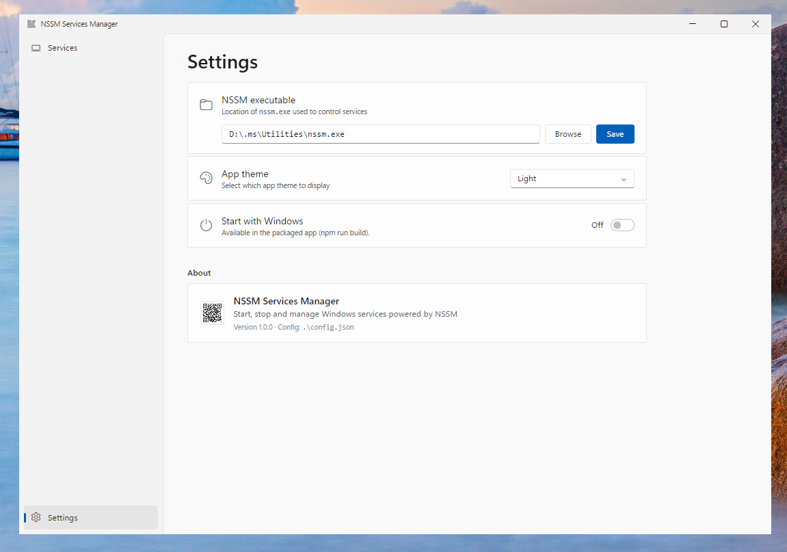

# NSSM Services Manager

A modern Windows 11-style desktop app to start, stop and manage Windows services. It works with every Windows
service on its own, and adds install, edit and remove for services run through
[NSSM](https://nssm.cc) (the Non-Sucking Service Manager) when `nssm.exe` is available.



Built with [Neutralino.js](https://neutralino.js.org) and Tailwind CSS, following Windows 11 / WinUI design: a
navigation pane, Settings-style expandable cards, toggle switches, light and dark themes, and a frameless custom
title bar. The whole app is **a single exe of a few MB**, because it uses the WebView2 browser engine that already
ships with Windows instead of bundling its own.

## Features

- **Browse every Windows service** with live status (refreshes every 5 seconds)
- **Start, stop and restart** services with a toggle switch. This works without NSSM, using Windows' own service
  controls (and uses `nssm.exe` when it is available)
- **Install, edit and remove** NSSM services (needs `nssm.exe`; edit opens NSSM's own editor)
- **Expand a service** to see its description, service name, status, startup type, log-on account and executable path
- **Filter** by status, startup type (including delayed start) and log-on account, plus an "NSSM only" view
- **Search** by name, display name or description
- **Light, Dark or follow-system theme**
- **Start with Windows** option (Settings), using a Scheduled Task so it runs with administrator rights
- Keyboard shortcuts: `F5` refresh, `Ctrl+F` search, `Esc` close dialogs

## Requirements

- Windows 10 or 11 (the design targets Windows 11)
- The [WebView2 runtime](https://developer.microsoft.com/microsoft-edge/webview2/). It is built into Windows 11 and
  already installed on almost all Windows 10 machines.
- [`nssm.exe`](https://nssm.cc/download) is **optional**. Without it you can still browse, start, stop and restart
  services; only install, edit and remove need it. See [NSSM detection](#nssm-detection).
- Administrator rights to start, stop, install or remove services. The app opens normally without a UAC prompt, so
  you can browse services right away. A banner offers **Restart as administrator** when you need to change something.

## Install

Download the latest build from the [Releases](../../releases) page:

| File | What it is |
| --- | --- |
| `NSSMServicesManager-<version>.exe` | The app. A single file, no installation needed |
| `SHA256SUMS.txt` | Checksums to verify the download |

Put the exe anywhere you like. If the build is not code-signed, Windows SmartScreen shows "Windows protected your PC"
on first run (**More info → Run anyway**). See [Code signing](#code-signing) to remove that warning.

## First run

1. Start the app. If it finds `nssm.exe` by itself (see below), it opens straight to the **Services** page.
2. Otherwise a welcome screen explains that NSSM is optional. Choose **Browse → Save** to set `nssm.exe`, or click
   **Skip for now**. The screen is not shown again after that.
3. On the **Services** page, use the switch on a service to start or stop it.



### NSSM detection

The app looks for `nssm.exe` in this order and uses the first one it finds:

1. The path saved in **Settings**
2. The **same folder as the app** (drop `nssm.exe` next to the exe)
3. Any folder on your **PATH**

Settings shows which one is in use. Without NSSM, the **New service**, **Edit** and **Remove** buttons are disabled
with a hint, and everything else keeps working.



## Configuration

Settings are saved in `config.json` in the same folder as the exe:

```json
{
  "nssmPath": "C:\\tools\\nssm\\win64\\nssm.exe",
  "theme": "system",
  "onboarded": true
}
```

`nssmPath` is optional (leave it out to use auto-detection). `theme` is `system`, `light` or `dark`. `onboarded` is
set once the welcome screen has been dealt with. You normally change these in the app's Settings page.

### Start with Windows

Turn on **Settings → Start with Windows** to launch the app at sign-in. Windows does not start elevated apps from
the usual startup registry key, so the app registers a Scheduled Task named `NSSM Services Manager` (trigger: at
logon, highest privileges). Turning the option off removes the task. If you move the exe, the task is updated the
next time you start the app. This option is only available in the built exe, not when running from source.

## Development

Requirements: [Node.js](https://nodejs.org) 22 or newer.

```bash
npm install
npm run setup    # downloads the Neutralino binary and client library (once)
npm run dev      # builds the CSS and launches the app
```

Run the terminal as administrator if you want to test starting and stopping services, or use the in-app
**Restart as administrator** button.

| Script | Purpose |
| --- | --- |
| `npm run setup` | Download the Neutralino binary into `bin/` and the client library into `resources/js/` |
| `npm run dev` | Build the CSS and run the app from source |
| `npm run css` | Build `resources/styles.css` from `src/input.css` |
| `npm run css:watch` | Rebuild the CSS on change |
| `npm run build` | Build the single-file exe into `dist/` |

### Project layout

```
neutralino.config.json  App window and permission settings
resources/              The UI: index.html, app.js, api.js, assets/, icons/ (styles.css is generated)
  api.js                Bridge to Windows: NSSM and PowerShell calls, config, theme, startup task
  app.js                The UI logic
src/input.css           Tailwind source with the Windows 11 design tokens
tailwind.config.js      Maps Tailwind colors to the design tokens
scripts/build.js        Stamps the exe (icon, version info) and builds it
build/                  App icon (icon.ico and icon.png)
```

### How commands run safely

Neutralino starts commands through the shell, so values such as service names and paths are never put on a command
line. Every PowerShell script receives its data as base64-encoded variables and is itself passed with
`-EncodedCommand`, so the command line only contains base64 characters. The app's window is also limited to the few
Neutralino functions it needs (`nativeAllowList` in `neutralino.config.json`).

## Releasing

A GitHub Actions workflow ([release.yml](.github/workflows/release.yml)) builds and publishes a release when you
push a version tag:

```bash
git tag v1.2.0
git push origin v1.2.0
```

The app version is taken from the tag. Tags that contain a dash, such as `v1.2.0-beta.1`, are published as
pre-releases. If the release step fails with a permissions error, set **Settings → Actions → General → Workflow
permissions** to "Read and write".

## Code signing

Free code signing provided by [SignPath.io](https://about.signpath.io/), certificate by
[SignPath Foundation](https://signpath.org/).

- **Committers, reviewers and approvers:** [muath-ye](https://github.com/muath-ye)
- **Privacy policy:** this program will not transfer any information to other networked systems unless specifically
  requested by the user or the person installing or operating it.

Release exes are built by the [release workflow](.github/workflows/release.yml) on GitHub's own runners and signed
by SignPath, so the publisher Windows shows is **SignPath Foundation**, and SmartScreen warnings fade as the file
builds reputation. Forks and local builds are unsigned.

### Setting up signing (maintainer)

1. Apply at [signpath.org/apply](https://signpath.org/apply). The repository must be public with an OSI-approved
   license (this one is MIT) and the README must carry the policy text above.
2. After approval, in SignPath create the project `nssm-services-manager` (slug) with a signing policy named
   `release-signing`, link it to this GitHub repository as a trusted build system, and create an API token for a CI
   user.
3. In GitHub, **Settings → Secrets and variables → Actions**, add:

   | Type | Name | Value |
   | --- | --- | --- |
   | Secret | `SIGNPATH_API_TOKEN` | The CI user's API token |
   | Variable | `SIGNPATH_ORGANIZATION_ID` | Your SignPath organization ID |

4. Push a version tag. The workflow uploads the built exe, SignPath signs it (the signing policy may wait for you
   to approve the request in SignPath), and the signed exe is verified before it is attached to the release.

The slugs in the workflow (`nssm-services-manager`, `release-signing`) and the artifact configuration in
[`.signpath/artifact-configurations/default.xml`](.signpath/artifact-configurations/default.xml) must match what you
create in SignPath. Without the token the workflow still builds a release, unsigned.

On your own machine you can skip the warning for a file you trust: right-click the exe → **Properties → Unblock**,
or run `Unblock-File .\NSSMServicesManager-<version>.exe`.

## License

[MIT](LICENSE)
